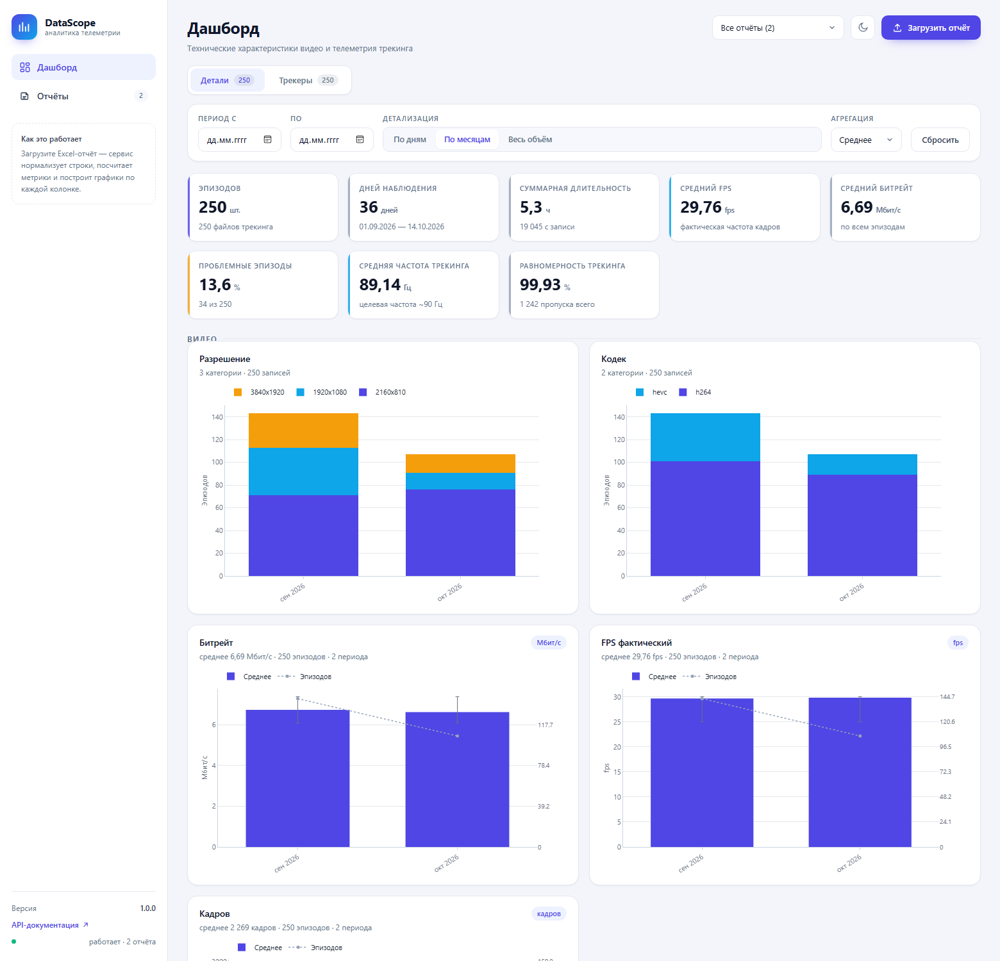
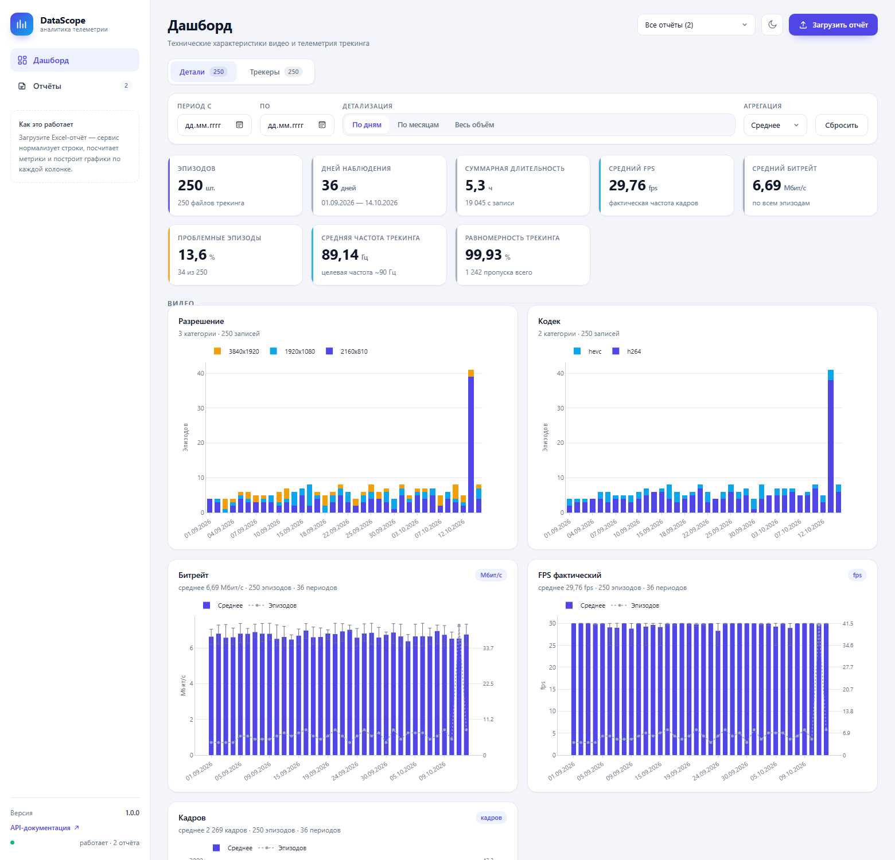
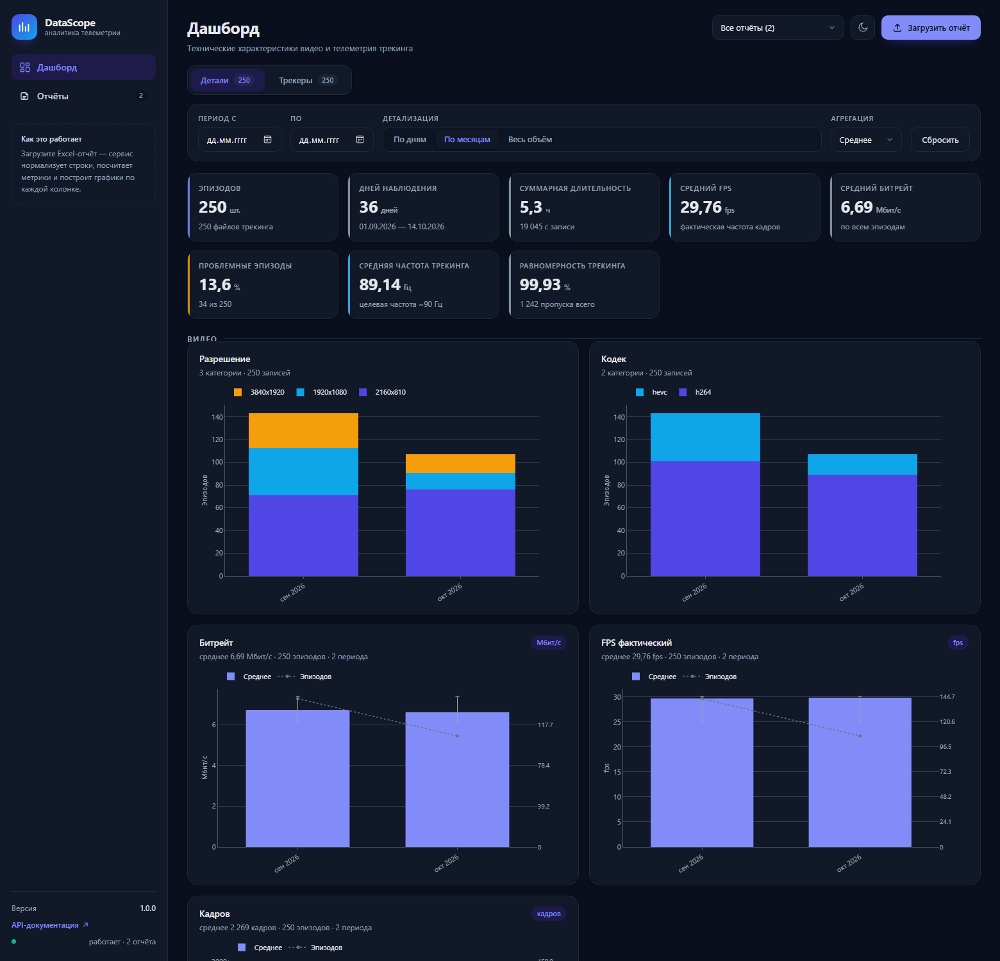
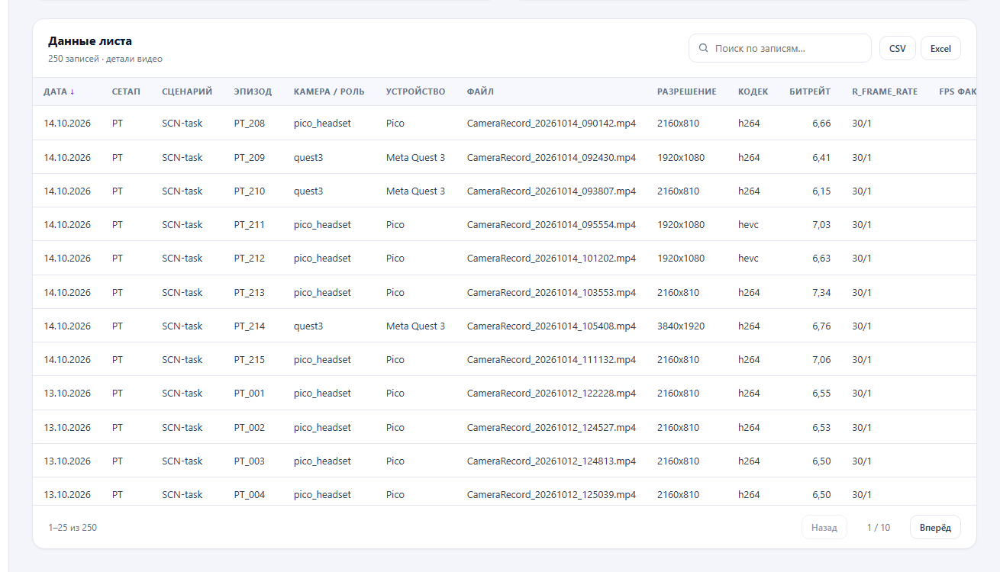
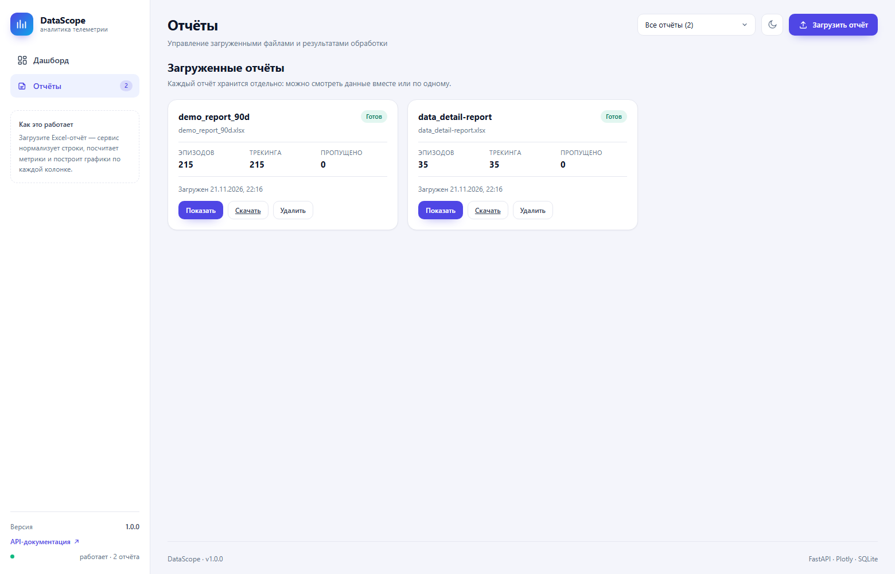
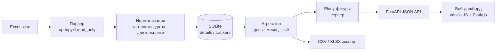
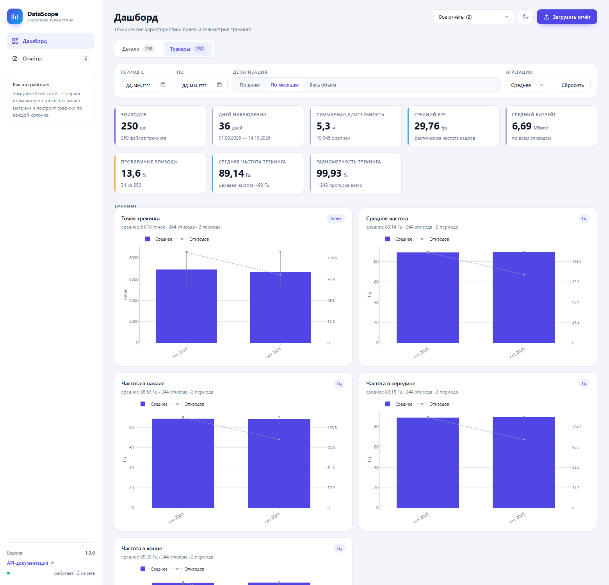

# DataScope — сервис обработки и визуализации данных

Сервис принимает Excel-отчёты с техническими характеристиками видео и файлами
трекинга, приводит их к единой модели, считает агрегаты по дням, месяцам и всему
объёму данных и строит интерактивный дашборд с графиком по **каждой** метрике.




## Содержание

- [Задача](#задача)
- [Возможности](#возможности)
- [Быстрый старт](#быстрый-старт)
- [Интерфейс](#интерфейс)
- [Архитектура](#архитектура)
- [Структура проекта](#структура-проекта)
- [Метрики и графики](#метрики-и-графики)
- [REST API](#rest-api)
- [Конфигурация](#конфигурация)
- [Демонстрационные данные](#демонстрационные-данные)
- [Тесты и качество кода](#тесты-и-качество-кода)
- [Артефакты работы с ИИ](#артефакты-работы-с-ии)
- [Документация](#документация)
- [Ограничения и планы](#ограничения-и-планы)
- [Лицензия](#лицензия)

## Задача

Исходный отчёт (`data/raw/data_detail-report.xlsx`) содержит листы:

| Лист | Содержимое | Колонок | Из них метрик |
|------|------------|---------|----------------|
| **Детали** | технические характеристики видеофайлов: разрешение, кодек, битрейт, FPS, кадры, длительность, «плохие» интервалы, разрывы, категория | 19 | 14 |
| **Трекеры** | телеметрия трекинга: точки, частота в начале/середине/конце, равномерность, пропуски, разрывы, категория | 16 | 12 |
| **Сводка** | исходные счётчики категорий (сервис считает их самостоятельно) | — | — |

Нужно было получить сервис, который:

1. выдерживает большие объёмы строк и не теряет данные при загрузке;
2. ведёт учёт метрик **по дням, месяцам и на всём объёме**;
3. строит информативный график по каждой метрике на листах «Детали» и «Трекеры»;
4. имеет понятную структуру проекта, документацию и тесты — для публикации на GitHub.

## Возможности

- **Загрузка отчётов `.xlsx` / `.xlsm`** через интерфейс или `POST /api/reports`.
  Парсер потоковый (`openpyxl.read_only`), поэтому файл не загружается в память целиком.
- **Нормализация «грязных» данных**: заголовки с кавычками и пунктуацией, числа с запятой,
  даты `13.10.2026`, длительности `1м 14с` и `01:14`, отсутствующие даты и FPS
  восстанавливаются из имени файла и из кадров/длительности.
- **Идемпотентность**: повторная загрузка того же файла определяется по SHA-256 и
  не создаёт дубль.
- **Агрегации по дням / месяцам / всему объёму**: среднее, сумма, минимум, максимум.
- **26 графиков** (14 на «Деталях» + 12 на «Трекерах»): столбцы по периодам с
  разбросом min–max, линия количества записей на второй оси, стековые диаграммы
  категорий, гистограммы распределения для режима «весь объём».
- **8 KPI-карточек**: эпизоды, дни наблюдения, суммарная длительность, средний FPS,
  битрейт, доля проблемных эпизодов, частота и равномерность трекинга.
- **Фильтры**: период, конкретный отчёт, поиск по таблице; сортировка по любой колонке.
- **Экспорт** текущей выборки в CSV (UTF-8 с BOM, `;` для Excel) и XLSX.
- **Тёмная тема**, адаптивная вёрстка, Plotly работает офлайн (библиотека лежит в проекте).
- **REST API** с OpenAPI/Swagger, кэш агрегатов, журналирование, обработка ошибок.
- **78 автотестов** и CI на GitHub Actions.

## Быстрый старт

Требуется Python 3.10+.

```bash
git clone <url-репозитория>
cd Сервис_обработки_и_визуализации_данных

python -m venv .venv
# Windows: .venv\Scripts\activate
# Linux/macOS: source .venv/bin/activate

pip install -r requirements.txt
python -m src.main
```

Откройте:

- дашборд — <http://127.0.0.1:8000/>
- Swagger — <http://127.0.0.1:8000/docs>
- ReDoc — <http://127.0.0.1:8000/redoc>

При первом запуске сервис создаёт `data/app.db` и автоматически импортирует
отчёты из `data/raw/` (исходный и демонстрационный). Отключить автоимпорт:
`DASHBOARD_AUTO_SEED=false` или переменная в `.env`.

Другие способы запуска:

```bash
uvicorn src.main:app --reload            # стандартный запуск ASGI
python scripts/ingest_report.py report.xlsx   # импорт без HTTP-сервера
pytest                                     # тесты
```

## Интерфейс

| Детализация по дням | Тёмная тема |
|---|---|
|  |  |

| Таблица данных | Управление отчётами |
|---|---|
|  |  |

Как читать график числовой метрики:

- **столбец** — выбранная агрегация метрики за период (среднее по умолчанию);
- **усы** — минимальное и максимальное значение внутри периода;
- **пунктирная линия** — количество эпизодов в периоде (правая ось).

В режиме **«Весь объём»** вместо столбцов по периодам строится гистограмма
распределения со средним значением, а категориальные метрики показываются
рейтингом. Лист «Трекеры» повторяет ту же логику для телеметрии.

## Архитектура



| Слой | Модули | Ответственность |
|------|--------|-----------------|
| API | `src/api/*` | HTTP-маршруты, валидация параметров, схемы ответов |
| Сервисы | `src/services/*` | парсинг, нормализация, агрегация, графики, KPI |
| Хранение | `src/services/{database,repository}.py` | схема SQLite, репозиторий, параметризованные запросы |
| Утилиты | `src/utils/*` | кэш, ошибки, журналирование |
| Интерфейс | `src/components/*`, `src/styles/*` | HTML/JS-компоненты, стили, вендорный Plotly.js |

Подробнее: [docs/architecture.md](docs/architecture.md).

## Структура проекта

```text
.
├── README.md                   # описание, стек, запуск
├── PROMPTS.md                  # дневник промптов
├── REFLECTION.md               # рефлексия по работе с агентом
├── .gitignore
├── requirements.txt            # зависимости сервиса
├── requirements-dev.txt        # pytest, ruff, httpx
├── pyproject.toml              # метаданные, pytest, ruff, package-data
├── src/                        # исходный код приложения
│   ├── main.py                 # точка входа: create_app() + uvicorn
│   ├── config.py               # настройки из переменных окружения
│   ├── api/                    # HTTP-слой
│   │   ├── deps.py             # зависимости (БД, кэш)
│   │   ├── routes_pages.py     # отдача дашборда
│   │   ├── routes_reports.py   # загрузка/список/удаление отчётов
│   │   ├── routes_analytics.py # каталог, дашборд, графики, таблица, экспорт
│   │   └── schemas.py          # Pydantic-схемы API
│   ├── components/             # UI-компоненты
│   │   ├── index.html          # Jinja2-шаблон дашборда
│   │   ├── favicon.svg
│   │   ├── js/
│   │   │   ├── api.js          # клиент REST API
│   │   │   ├── charts.js       # обёртка Plotly.react
│   │   │   └── app.js          # состояние, фильтры, таблица, загрузка
│   │   └── vendor/plotly.min.js
│   ├── styles/
│   │   └── app.css             # светлая/тёмная тема, адаптивность
│   ├── services/               # логика, работа с API и БД
│   │   ├── catalog.py          # каталог листов и метрик
│   │   ├── normalization.py    # разбор заголовков и значений
│   │   ├── parser.py           # потоковое чтение Excel
│   │   ├── ingest.py           # конвейер импорта
│   │   ├── aggregator.py       # ряды, распределения, KPI
│   │   ├── charts.py           # Plotly-фигуры
│   │   ├── dashboard.py        # сборка ответа дашборда
│   │   ├── database.py         # схема SQLite и подключение
│   │   └── repository.py       # SQL-запросы и агрегации
│   └── utils/                  # вспомогательные функции
│       ├── cache.py            # TTL/LRU-кэш
│       ├── errors.py           # доменные ошибки → HTTP
│       └── logging.py          # настройка журналирования
├── tests/                      # 78 тестов pytest
│   ├── conftest.py
│   ├── test_api.py
│   ├── test_parser.py
│   ├── test_normalization.py
│   ├── test_aggregator.py
│   └── test_charts.py
├── docs/
│   ├── architecture.md         # схема компонентов и решения
│   ├── api.md                  # описание REST API
│   ├── data-model.md           # модель данных и нормализация
│   ├── metrics.md              # метрики, графики, KPI
│   ├── user-guide.md           # руководство пользователя
│   ├── development.md          # как расширять проект
│   ├── report.md               # отчёт о разработке
│   ├── demo.mp4                # видео-демонстрация (30–60 сек)
│   └── screenshots/            # скриншоты интерфейса
├── .agent/                     # артефакты работы с ИИ
│   ├── prompt-log.md           # хронология запросов к агенту
│   ├── errors.md               # ошибки агента и исправления
│   └── config.json             # модель, режим, инструменты
├── data/
│   ├── raw/                    # исходные отчёты (в репозитории)
│   │   ├── data_detail-report.xlsx
│   │   └── demo_report_90d.xlsx
│   ├── app.db                  # создаётся при запуске (в .gitignore)
│   ├── uploads/                # загруженные файлы (в .gitignore)
│   └── exports/                # временные выгрузки XLSX (в .gitignore)
├── scripts/
│   ├── generate_demo_report.py # генератор демо-отчёта
│   └── ingest_report.py        # импорт отчёта в БД из CLI
├── .github/workflows/ci.yml    # линтер + тесты на GitHub Actions
├── Makefile
├── .env.example
├── CHANGELOG.md
└── LICENSE
```

## Метрики и графики

Каталог метрик описан в одном месте — `src/services/catalog.py`. Там же хранятся
алиасы заголовков, единицы измерения, формат и допустимые агрегации.

**«Детали»** (14 графиков): сетап, сценарий, камера/роль, устройство, разрешение,
кодек, битрейт, FPS, кадры, длительность, «плохие» интервалы, их доля, максимальный
разрыв, категория.

**«Трекеры»** (12 графиков): сетап, сценарий, точки, длительность, средняя частота,
частота в начале/середине/конце, равномерность, пропуски, максимальный разрыв,
категория.

Полное описание метрик, формул KPI и правил фильтрации нулевых значений:
[docs/metrics.md](docs/metrics.md).



## REST API

Базовый префикс — `/api`. Полная интерактивная документация: `/docs`.

| Метод | Путь | Назначение |
|-------|------|------------|
| `GET` | `/api/health` | статус, счётчики строк, статистика кэша |
| `GET` | `/api/catalog` | листы, колонки, метрики, агрегации |
| `GET` | `/api/reports` | список отчётов |
| `POST` | `/api/reports` | загрузка отчёта (`multipart/form-data`) |
| `GET` | `/api/reports/{id}` | карточка отчёта |
| `GET` | `/api/reports/{id}/download` | скачать исходный файл |
| `DELETE` | `/api/reports/{id}` | удалить отчёт и его строки |
| `GET` | `/api/dashboard` | KPI и все графики листа |
| `GET` | `/api/charts/{sheet}/{metric}` | один график |
| `GET` | `/api/table/{sheet}` | страница таблицы с поиском и сортировкой |
| `GET` | `/api/export/{sheet}.csv` | экспорт выборки в CSV |
| `GET` | `/api/export/{sheet}.xlsx` | экспорт выборки в Excel |

Пример:

```bash
curl "http://127.0.0.1:8000/api/dashboard?sheet=details&granularity=month&aggregation=avg"
curl -X POST "http://127.0.0.1:8000/api/reports" -F "file=@report.xlsx"
```

Подробные параметры и примеры ответов: [docs/api.md](docs/api.md).

## Конфигурация

Все настройки читаются из переменных окружения с префиксом `DASHBOARD_`
(шаблон — `.env.example`).

| Переменная | По умолчанию | Назначение |
|------------|--------------|------------|
| `DASHBOARD_APP_NAME` | `DataScope` | название в интерфейсе |
| `DASHBOARD_DATA_DIR` | `./data` | каталог данных |
| `DASHBOARD_DB_PATH` | `<data>/app.db` | путь к SQLite |
| `DASHBOARD_MAX_UPLOAD_MB` | `256` | лимит размера файла |
| `DASHBOARD_CACHE_TTL_SECONDS` | `300` | время жизни кэша |
| `DASHBOARD_AUTO_SEED` | `true` | импорт отчётов из `data/raw` при пустой БД |
| `DASHBOARD_LOG_LEVEL` | `INFO` | уровень журналирования |

## Демонстрационные данные

В репозитории два отчёта:

- `data/raw/data_detail-report.xlsx` — исходный отчёт (35 эпизодов за 13.10.2026);
- `data/raw/demo_report_90d.xlsx` — синтетический набор на 36 съёмочных дней
  (сентябрь–октябрь 2026, 215 эпизодов) для проверки агрегаций по дням и месяцам.

Пересоздать демо-набор:

```bash
python scripts/generate_demo_report.py --days 36 --per-day 6 --seed 42
```

Отчёт генерируется детерминированно, содержит реалистичные аномалии: редкие
пропуски FPS, «плохие» интервалы, битые файлы трекинга. Через селектор отчётов
можно смотреть данные вместе или по отдельности.

## Тесты и качество кода

```bash
pip install -r requirements-dev.txt
pytest          # 78 тестов
ruff check app scripts tests
```

Покрыто:

- нормализация заголовков, чисел, дат, длительностей и имён файлов;
- потоковый парсер, пропуск пустых строк, неизвестные колонки, восстановление полей;
- импорт, дедупликация по SHA-256, агрегации, KPI, поиск и сортировка;
- все эндпоинты API, загрузка/удаление, экспорт CSV и XLSX, коды ошибок;
- структура Plotly-фигур для всех трёх типов визуализации.

CI (`.github/workflows/ci.yml`) запускает линтер и тесты на Python 3.10–3.13.

## Артефакты работы с ИИ

Проект выполнялся вместе с агентом DeepSeek Harness, поэтому в репозитории
сохранены материалы этой работы:

- [PROMPTS.md](PROMPTS.md) — дневник промптов: исходная постановка, уточнения,
  правки по структуре проекта;
- [REFLECTION.md](REFLECTION.md) — рефлексия: что получилось, что пришлось
  переделывать и что стоит улучшить;
- [.agent/prompt-log.md](.agent/prompt-log.md) — хронология запросов и действий;
- [.agent/errors.md](.agent/errors.md) — ошибки агента и способы их исправления;
- [.agent/config.json](.agent/config.json) — модель, режим и инструменты.

Видео-демонстрация: [docs/demo.mp4](docs/demo.mp4) (30–60 секунд, обзор
дашборда, фильтров, листа «Трекеры» и управления отчётами).

## Документация

- [Отчёт о разработке](docs/report.md)
- [Архитектура и принятые решения](docs/architecture.md)
- [REST API: параметры и примеры](docs/api.md)
- [Модель данных и правила нормализации](docs/data-model.md)
- [Каталог метрик и формулы KPI](docs/metrics.md)
- [Руководство пользователя](docs/user-guide.md)
- [Разработка: как расширять проект](docs/development.md)
- [История изменений](CHANGELOG.md)
- [Видео-демонстрация](docs/demo.mp4)

## Ограничения и планы

- SQLite выбран для простоты развёртывания; при переходе на PostgreSQL слой
  репозитория меняется без изменения API.
- Разбор больших файлов выполняется в потоковом режиме, но импорт остаётся
  синхронным запросом; для файлов в сотни тысяч строк имеет смысл вынести его
  в очередь задач (Celery/RQ) и добавить прогресс.
- Нет аутентификации: сервис рассчитан на локальный запуск или доверенную сеть.
- В планах: сравнение отчётов между собой, выгрузка PNG-отчёта, планировщик
  регулярной загрузки, PostgreSQL и партиционирование по датам.

## Лицензия

MIT — см. [LICENSE](LICENSE).
