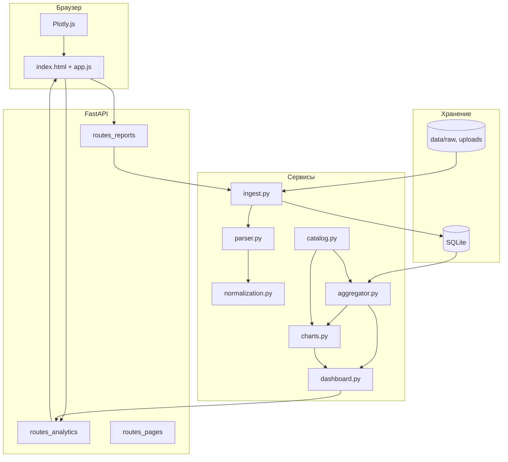
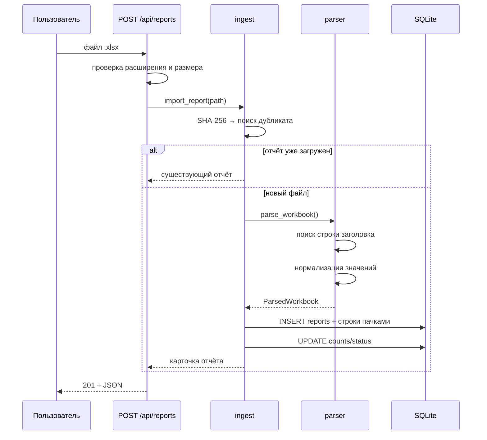
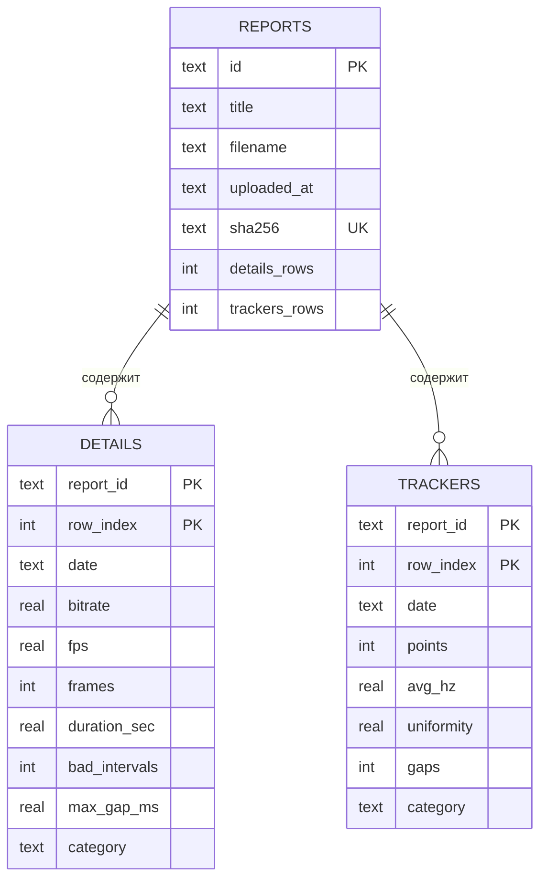

# Архитектура сервиса

Документ описывает устройство DataScope, принятые решения и точки роста.
Схема компонентов и структура каталогов — в [README](../README.md).

## 1. Требования и ограничения

| Требование | Решение |
|------------|---------|
| Большие объёмы строк в отчётах | потоковое чтение Excel, пакетная вставка, SQL-агрегация вместо pandas |
| Учёт по дням, месяцам и всему объёму | период вычисляется в SQL (`date`, `substr(date,1,7)`, `'all'`) |
| График по каждой метрике | каталог метрик + универсальный построитель Plotly-фигур |
| Простота развёртывания и защиты | один процесс Python, SQLite, статика без сборки |
| Воспроизводимость и проверяемость | 78 тестов, CI, фиксированный демо-набор |

## 2. Слои приложения

Слои разделены по ответственности:

1. **API** (`src/api`) — только HTTP: разбор параметров, вызов сервиса, сериализация.
2. **Сервисы** (`src/services`) — бизнес-логика, не знают про FastAPI.
3. **Хранение** (`src/services/database.py`, `repository.py`) — SQL, схема, транзакции.
4. **Утилиты** (`src/utils`) — кэш, ошибки, логирование.
5. **Интерфейс** (`src/components`, `src/styles`) — шаблон, JS-модули, CSS.

Такое разделение позволяет тестировать парсер и агрегатор без поднятия сервера,
а также заменить SQLite на PostgreSQL, не меняя контракт API.

## 3. Поток импорта отчёта

Ключевые решения:

- **Потоковое чтение.** `openpyxl.load_workbook(read_only=True)` отдаёт строки
  генератором; в память попадает только буфер первых 15 строк для поиска шапки.
- **Автопоиск шапки.** В отчёте над таблицей есть служебная строка `data | Детали`.
  Парсер выбирает строку с максимальным числом распознанных колонок (минимум 2),
  поэтому лишние заголовки и пустые строки не ломают импорт.
- **Пакетная вставка.** Строки пишутся блоками по 2000 через `executemany` в одной
  транзакции отчёта: при ошибке откатывается весь отчёт, а не половина.
- **Идемпотентность.** Перед разбором считается SHA-256; повторная загрузка
  возвращает существующий отчёт с `duplicate: true`.
- **Расширяемость.** Неизвестные колонки не теряются: они попадают в `extra` (JSON)
  и в `search_text`, а название колонки — в сообщение отчёта.

Подробности правил нормализации — в [data-model.md](data-model.md).

## 4. Хранение

- Нормализованная схема вместо «сырых» листов: агрегаты считаются индексами,
  а не перебором JSON.
- Индексы по `date`, `report_id`, `category` закрывают фильтры и группировки.
- `PRAGMA journal_mode=WAL` — параллельные чтения во время импорта.
- Даты хранятся строками ISO (`YYYY-MM-DD`), поэтому лексикографическая сортировка
  совпадает с хронологической, а месяц — это `substr(date, 1, 7)`.
- Удаление отчёта каскадное (`ON DELETE CASCADE`), файл на диске удаляется отдельно.

## 5. Агрегация и визуализация

`aggregator.py` формирует данные, `charts.py` — фигуры Plotly, `dashboard.py`
собирает карточки с подписями и KPI.

| Режим | Числовая метрика | Категориальная метрика |
|-------|------------------|------------------------|
| `day` | столбцы среднего/суммы по дням, усы min–max, линия количества | стековые столбцы по дням |
| `month` | то же по месяцам | стековые столбцы по месяцам |
| `all` | гистограмма распределения + линия среднего | горизонтальный рейтинг категорий |

- Фигуры строятся на сервере и отдаются как Plotly JSON — клиент не считает данные.
- Тема (`light`/`dark`) влияет на цвета фигуры и передаётся параметром.
- Максимум 8 категорий на графике, остальные объединяются в «Другие (N)»,
  чтобы легенда оставалась читаемой.
- Для частот и равномерности нулевые значения считаются отсутствием данных
  (`positive_only` в каталоге): битый файл трекинга не должен занижать среднюю частоту.

## 6. Кэширование и производительность

- `TTLCache` (LRU + TTL, по умолчанию 300 с) хранит готовые ответы дашборда и
  графиков; ключ включает лист, метрику, детализацию, агрегацию, фильтры и тему.
- Кэш полностью сбрасывается при импорте и удалении отчёта.
- `GZipMiddleware` сжимает JSON (ответ дашборда — десятки килобайт).
- Один запрос `/api/dashboard` отдаёт все 14/12 графиков, поэтому переключение
  вкладок не порождает каскад запросов.
- Ответы таблицы ограничены `limit` (по умолчанию 25, максимум 500).

Оценка: отчёт на 250 строк обрабатывается за доли секунды; на 100 000 строк
основное время уходит на разбор Excel, агрегации выполняются индексами SQLite.

## 7. Ошибки и наблюдаемость

- Доменные ошибки (`ServiceError`) преобразуются в JSON
  `{"error": {"code", "message", "details"}}` с кодом 400/404/413/422.
- Ошибки парсинга содержат имя файла и причину, но не стек вызовов.
- Каждый HTTP-ответ содержит `X-Process-Time-Ms`.
- `/api/health` отдаёт версию, счётчики строк, путь к БД и статистику кэша
  (hits/misses/hit rate) — удобно для smoke-тестов и мониторинга.

## 8. Безопасность

- Все SQL-запросы параметризованы; имена таблиц и колонок берутся из белых списков
  (`SHEET_TABLES`, `GRID`/каталог), сортировка проверяется по `PRAGMA table_info`.
- Имена загруженных файлов очищаются от небезопасных символов, файл пишется
  в контролируемый каталог `data/uploads`.
- Ограничение размера действует при потоковой записи, а не после загрузки.
- CORS ограничен методами `GET/POST/DELETE`; аутентификация не предусмотрена —
  сервис рассчитан на локальный запуск или доверенную сеть (см. README).

## 9. Фронтенд без сборки

`src/components` и `src/styles` — Jinja2-шаблон, три ES5-совместимых модуля и CSS
(`api.js`, `charts.js`, `app.js`). Plotly.js (4.8 МБ) лежит в `static/vendor`,
поэтому дашборд работает без интернета и CDN. Состояние фильтров можно передать
ссылкой: `?sheet=trackers&granularity=month&theme=dark&view=reports`.

## 10. Точки роста

1. **Очередь импорта** для файлов >100 МБ: фоновая задача + прогресс в UI.
2. **PostgreSQL** и партиционирование по месяцам при объёме >10 млн строк.
3. **Сравнение отчётов** (diff метрик между выгрузками).
4. **Авторизация** и разграничение доступа к отчётам.
5. **Экспорт дашборда в PDF/PNG** через headless-браузер.
