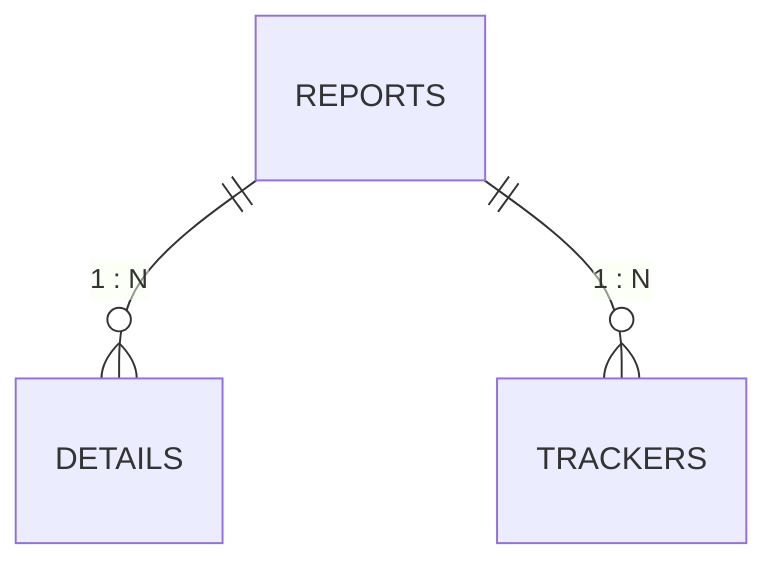

# Модель данных и нормализация

Сервис хранит отчёт не «как есть», а в нормализованном виде: каждая строка листа
становится записью таблицы `details` или `trackers`. Это позволяет агрегировать
данные индексами SQLite и не зависеть от порядка колонок в конкретной выгрузке.

## 1. Исходный отчёт

```
Лист «Детали»                          Лист «Трекеры»
┌──────────────────────────────┐      ┌──────────────────────────────┐
│ data | Детали                │ ← шапка-разделитель
│ Дата | Сетап | … | Категория │ ← строка заголовков
│ 13.10.2026 | PT | …          │
└──────────────────────────────┘
```

Парсер сам находит строку заголовков: среди первых 15 строк выбирается та,
в которой распознано больше всего колонок (минимум две). Строки выше шапки
игнорируются, поэтому служебный заголовок `data | Детали` не мешает импорту.

## 2. Правила нормализации

### Заголовки

Заголовок приводится к нижнему регистру, `ё → е`, кавычки и пунктуация
заменяются пробелами, пробелы схлопываются:

| В отчёте | Нормализовано | Колонка |
|----------|---------------|---------|
| `«Плохих» интерв., %` | `плохих интерв %` | `bad_intervals_pct` |
| `Битрейт, Мбит/с` | `битрейт мбит с` | `bitrate` |
| `r_frame_rate` | `r frame rate` | `r_frame_rate` |
| `FPS факт.` | `fps факт` | `fps` |
| `Ср. Гц` | `ср гц` | `avg_hz` |

Для каждой колонки в каталоге задан список алиасов. Если алиас не совпал,
включаются эвристики по ключевым словам (`fps`, `битрейт`, `кадр`, `разрыв`,
`гц`, `дат`, `файл` …). Неизвестные колонки не отбрасываются: они сохраняются
в JSON-поле `extra` и учитываются в поиске.

### Числа

`6,55` → `6.55`, `1 234,5` → `1234.5`, `99,9%` → `99.9`, `—`/`n/a`/пусто → `NULL`.
Пробелы (включая неразрывные) и знак `%` удаляются.

### Даты

Поддерживаются `13.10.2026`, `13.10.26`, `2026-10-13`, `13/10/2026`,
`13.10.2026 12:22`, объекты `date`/`datetime` и серийные номера Excel.
Хранится ISO-строка `YYYY-MM-DD`.

Если дата не указана, она восстанавливается из имени файла:
`CameraRecord_20261012_122228.mp4` → `2026-10-12`, время `12:22:28`
дополнительно пишется в `started_at`.

### Длительности

| Значение | Секунды |
|----------|---------|
| `1м 14с` | 74 |
| `01:14` | 74 |
| `1:02:03` | 3723 |
| `500 мс` | 0.5 |
| `74` | 74 |

Человекочитаемая строка сохраняется в `duration_text`, число — в `duration_sec`.

### Восстановление пропусков

| Что отсутствует | Как восстанавливается |
|-----------------|-----------------------|
| `fps` | `frames / duration_sec` |
| `frames` | `fps * duration_sec` |
| `avg_hz` (трекеры) | `points / duration_sec` |
| `points` | `avg_hz * duration_sec` |
| `date` | из имени файла |
| `duration_sec` | из `duration_text` |
| `duration_text` | из `duration_sec` |

Восстановленные значения не помечаются отдельно: исходные пустые ячейки
в отчёте означают «не указано», а расчёт опирается на те же физические величины.

### Пустые строки и мусор

Полностью пустые строки пропускаются и учитываются в `skipped_rows`.
Строка, где распознано хотя бы одно значение, сохраняется — даже если часть
полей пуста.

## 3. Схема SQLite

```sql
CREATE TABLE reports (
    id            TEXT PRIMARY KEY,      -- rep_<12 hex>
    title         TEXT NOT NULL,
    filename      TEXT NOT NULL,
    uploaded_at   TEXT NOT NULL,          -- ISO UTC
    size_bytes    INTEGER NOT NULL DEFAULT 0,
    sha256        TEXT,                   -- ключ дедупликации
    details_rows  INTEGER NOT NULL DEFAULT 0,
    trackers_rows INTEGER NOT NULL DEFAULT 0,
    skipped_rows  INTEGER NOT NULL DEFAULT 0,
    status        TEXT NOT NULL DEFAULT 'ready',  -- processing | ready | failed
    message       TEXT
);
CREATE UNIQUE INDEX idx_reports_sha256 ON reports (sha256);

CREATE TABLE details (
    report_id         TEXT NOT NULL REFERENCES reports (id) ON DELETE CASCADE,
    row_index         INTEGER NOT NULL,
    date              TEXT,      -- YYYY-MM-DD
    started_at        TEXT,      -- YYYY-MM-DD HH:MM:SS из имени файла
    setup             TEXT,
    scenario          TEXT,
    episode           TEXT,
    camera_role       TEXT,
    device            TEXT,
    file              TEXT,
    resolution        TEXT,
    codec             TEXT,
    bitrate           REAL,      -- Мбит/с
    r_frame_rate      TEXT,      -- «30/1»
    fps               REAL,
    frames            INTEGER,
    duration_text     TEXT,      -- «1м 14с»
    duration_sec      REAL,
    bad_intervals     INTEGER,
    bad_intervals_pct REAL,
    max_gap_ms        REAL,
    category          TEXT,
    extra             TEXT,      -- JSON неизвестных колонок
    search_text       TEXT,      -- нижний регистр всех значений
    PRIMARY KEY (report_id, row_index)
);

CREATE TABLE trackers (
    report_id     TEXT NOT NULL REFERENCES reports (id) ON DELETE CASCADE,
    row_index     INTEGER NOT NULL,
    date          TEXT,
    started_at    TEXT,
    setup         TEXT,
    scenario      TEXT,
    episode       TEXT,
    file          TEXT,
    points        INTEGER,
    duration_text TEXT,
    duration_sec  REAL,
    avg_hz        REAL,
    start_hz      REAL,
    mid_hz        REAL,
    end_hz        REAL,
    uniformity    REAL,          -- %
    gaps          INTEGER,
    max_gap_ms    REAL,
    category      TEXT,
    extra         TEXT,
    search_text   TEXT,
    PRIMARY KEY (report_id, row_index)
);
```

Индексы: `details(date)`, `details(report_id)`, `details(category)` и аналогичные
для `trackers`. `PRAGMA journal_mode=WAL`, `foreign_keys=ON`.

## 4. Связи и жизненный цикл



- Отчёт появляется со статусом `processing`, после успешного импорта — `ready`,
  при исключении — `failed` с текстом ошибки.
- Удаление отчёта каскадно удаляет строки; запись `reports` — единственный
  источник счётчиков для интерфейса.
- Повторная загрузка файла с тем же SHA-256 не создаёт новую запись.

## 5. Семантика полей

- `extra` — JSON-объект `{заголовок: значение}` для колонок, которых нет в каталоге.
  Позволяет не терять новые поля при изменении формата отчёта.
- `search_text` — конкатенация всех значений в нижнем регистре через ` | `.
  Используется поиском, потому что `LIKE` в SQLite не учитывает регистр кириллицы.
- `row_index` — порядковый номер строки внутри отчёта, обеспечивает стабильную
  сортировку при одинаковых датах.
- Денежные/физические единицы не конвертируются: битрейт — Мбит/с, разрывы — мс,
  частоты — Гц, как в исходном отчёте.

## 6. Проверки при импорте

1. Расширение `.xlsx`/`.xlsm` и наличие файла.
2. Наличие листа «Детали» или «Трекеры» (иначе `422`).
3. Наличие строки заголовка минимум с двумя распознанными колонками.
4. Наличие хотя бы одной строки данных.
5. Размер файла не больше `DASHBOARD_MAX_UPLOAD_MB`.
